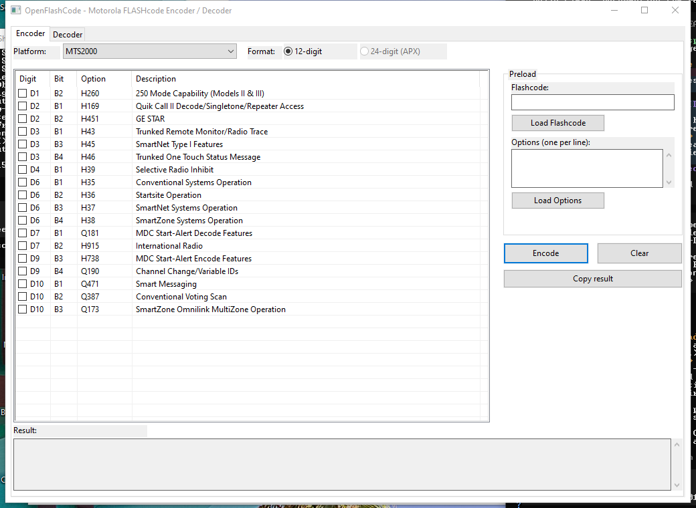
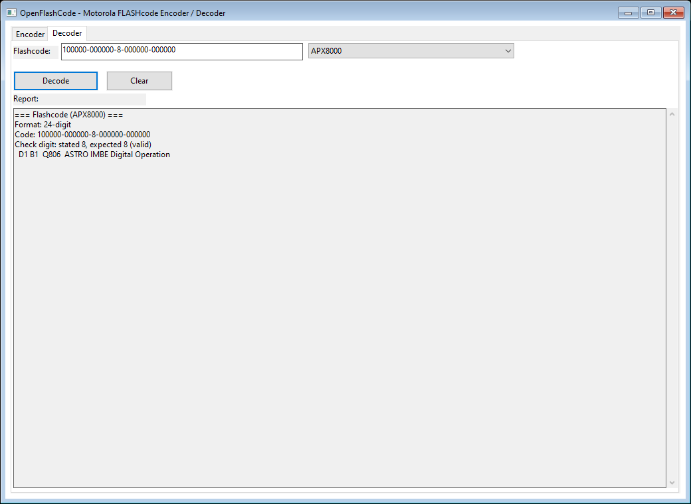

# OpenFlashCode

A native Win32 GUI encoder/decoder for Motorola radio FLASHcodes, written in C++.

OpenFlashCode is a desktop reimplementation of the browser-based akardam.net Flashcode Encoder and Decoder. It runs entirely offline: every radio option, alphabet, and check-digit rule is built into the executable.





## Features

- **Encoder and decoder in one window**, in separate tabs.
- **37 radio platforms**:
  - MTS2000, MCS2000, Astro Saber, XTS3000, Astro Spectra
  - XTS5000/4000, XTS2500, XTS1500, MT1500, PR1500, SSE5000
  - XTL5000, XTL2500, XTL1500, PM1500, Astro Spectra Plus
  - APX8000, APX7000, APX7000XE, APX6000, APX6000 BN, APX4000, APX3000
  - SRX2200, SRX2200 BN, APX1000, APX900, APX8500, APX8500 HP
  - APX7500, APX6500, APX6500 BN (Enh), APX4500, APX4500 BN (Enh)
  - TXM2000, APX1500, APX1500 BN (Enh)
- **Both FLASHcode formats**:
  - Legacy 12-character hexadecimal codes for MTS/MCS/Astro/Astro25 radios.
  - APX 12- or 24-character base-64 codes, including the extended format.
- **Correct check digit** using the reference Luhn-style algorithm over six-bit values.
- **Preload** by pasting an existing FLASHcode or a list of option codes.
- **Decode report** with format, stated/expected check digit, and every set option's code and description.
- Single-code decoder with a large report pane.

## Building

Requirements:

- Windows 10 or 11
- Visual Studio 2022 Build Tools with the **Desktop development with C++** workload
  (or a full Visual Studio installation)
- Windows SDK (installed with the C++ workload)

From a normal command prompt:

```bat
build.bat
```

The build script locates `vswhere.exe`, initializes the 64-bit MSVC environment, and writes:

```
build\OpenFlashCode.exe
```

The executable embeds its Common Controls v6 manifest, so it can be copied and run on its own.

## Using the encoder

1. Pick a platform.
2. Choose the 12-digit format, or the 24-digit format on APX radios.
3. Tick the options you want.
4. Press **Encode**.

The result pane shows the canonical code with a freshly computed check digit. For APX radios both the 12-digit and 24-digit representations are shown; **Copy result** copies the one matching the selected format.

**Preload** accepts either an existing FLASHcode or a list of option codes (one per line), then checks the matching boxes.

## Using the decoder

1. Paste a FLASHcode. Dashes and surrounding whitespace are optional.
2. Select the platform.
3. Press **Decode**.

The report shows the normalized code, the stated and expected check digit, and each set option. Bits that are set but undefined for the selected platform are reported as invalid.

## FLASHcode format

- A character stores a value in a fixed alphabet.
  - Legacy radios use hexadecimal: `0-9A-F`, case-insensitive.
  - APX radios use a 64-character alphabet with ambiguous glyphs removed:
    `0123456789ABCDEFGHJKLMNPQRSTUVWXYZabcdefghjkmnpqrstuvwxyz#(+$)&%`
- Legacy codes carry 12 data characters; APX codes carry 12 or 24.
- The check digit is a decimal `0-9`, computed as a Luhn variant over the data values:
  - even positions contribute the decimal digit sum of twice the value;
  - odd positions contribute the decimal digit sum of the value;
  - the digit brings the total to a multiple of ten.
- In text form the check digit is inserted after the second group of six characters:

```
AAAAAA-BBBBBB-C-DDDDDD-EEEEEE
```

## Project layout

```
src/
  main.cpp        Win32 GUI, layout, encoder/decoder wiring
  flashcode.cpp   format, parse, alphabet and check-digit engine
  flashcode.h
  flashdata.cpp   generated option database (37 platforms)
  flashdata.h
data/
  flashcodes.json option database source
tools/
  gen_data.ps1    regenerates src/flashdata.cpp from the JSON
  engine_test.cpp engine test suite
build.bat         MSVC build script
```

## Development

Regenerate the embedded option database after editing `data/flashcodes.json`:

```powershell
powershell -ExecutionPolicy Bypass -File tools\gen_data.ps1
```

Build and run the engine tests:

```bat
cl /nologo /EHsc /std:c++17 /I src tools\engine_test.cpp src\flashcode.cpp src\flashdata.cpp /Fe:build\engine_test.exe
build\engine_test.exe
```

The tests cover legacy and APX formatting, the base-64 alphabet, parsing, check digits, and sanity checks on every platform table.

## Notes and limitations

- Like the reference tool, the encoder does not reject incompatible option combinations; it is a code builder, not a radio configuration validator.
- The decoder accepts a wrong check digit and reports it as a mismatch instead of refusing the code.
- Option compatibility notes are stored in the database but are not shown as hover tooltips.
- This project is independent and is not affiliated with or endorsed by Motorola Solutions or akardam.net. Motorola, APX, SRX, and FLASHcode are trademarks of their respective owners.
